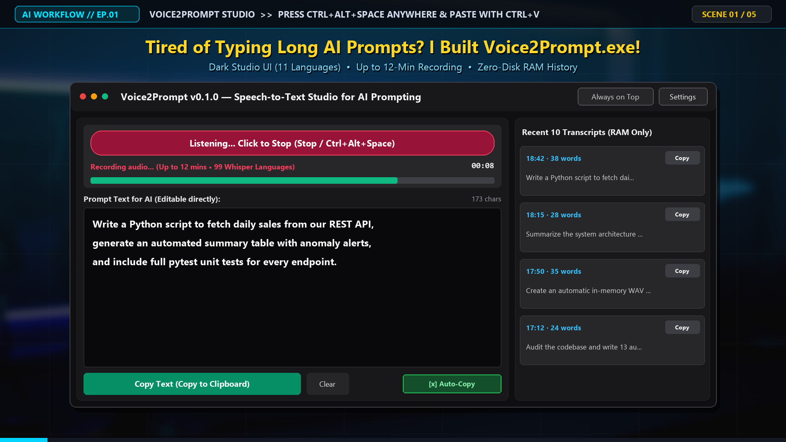

> 🌐 **Language / ภาษา:** **[🇬🇧 English](README.md)** | **[🇹🇭 ภาษาไทย](README.th.md)**

# 🎙️ Voice2Prompt (`v0.1.0`)

**โปรแกรมแปลงเสียงพูดเป็นข้อความ (Speech-to-Text) สำหรับคุยกับ AI บน Windows (ขับเคลื่อนด้วย Groq `whisper-large-v3`)**

[](#ความต้องการของระบบ)
[](LICENSE)
[](version.py)

**Voice2Prompt** คือโปรแกรม Desktop น้ำหนักเบาสำหรับ **Windows** ที่ช่วยให้คุณพูดสั่งงาน AI ยาวๆ ได้อย่างเป็นธรรมชาติ (รองรับทั้งภาษาไทยคำทับศัพท์ภาษาอังกฤษ และภาษาต่างประเทศ) แล้วคัดลอกข้อความลง Clipboard อัตโนมัติ เพื่อกด `Ctrl + V` วางใน **Claude Code, Cursor, ChatGPT, Gemini หรือหน้าต่าง Terminal/IDE** ได้ทันทีโดยไม่ต้องสลับหน้าต่างกลับมาที่ตัวโปรแกรม

> **⚠️ ข้อกำหนดสำคัญก่อนใช้งาน:**
> - **รองรับเฉพาะระบบปฏิบัติการ Windows เท่านั้น (Windows Only):** เนื่องจากใช้ระบบปุ่มลัดระดับ OS ผ่าน Win32 API (`RegisterHotKey` ใน `user32.dll`) และการตั้งค่าความคมชัดหน้าจอ DPI ของ Windows
> - **ต้องใช้ Groq API Key ของคุณเอง:** ผู้ใช้ต้องสมัครและนำ Groq API Key ของตนเองมาใส่ (สมัครรับคีย์ฟรีได้ที่ [console.groq.com/keys](https://console.groq.com/keys))


*(พื้นที่สำหรับภาพหน้าจอโปรแกรม — แนะนำให้แคปภาพหน้าต่างโปรแกรมจริงของคุณแล้วบันทึกไว้ที่ `docs/screenshot.png`)*

---

## ✨ ฟีเจอร์หลัก (Key Features)

- **⚡ แปลงเสียงความแม่นยำสูงผ่าน Cloud (`whisper-large-v3`):** ประมวลผลผ่านชิป LPU ของ Groq ช่วยให้ถอดความเสียงพูดเป็นข้อความได้อย่างรวดเร็วและแม่นยำ (ความเร็วในการตอบกลับขึ้นอยู่กับความเสถียรของอินเทอร์เน็ตและความยาวของเสียงที่พูด)
- **🌍 รองรับ 99 ภาษาตามมาตรฐาน Whisper (มีให้เลือกในหน้าตั้งค่า 11 ภาษายอดนิยม + ตรวจจับอัตโนมัติ):**
  - โมเดล Groq `whisper-large-v3` รองรับการถอดความเสียงพูดทั้งหมด **99 ภาษา**
  - ในหน้าตั้งค่าของโปรแกรมมีเมนูเลือกภาษาที่ใช้พูด **11 ภาษายอดนิยม** ที่ตรวจสอบรหัส ISO-639-1 ตรงตามเอกสารของ Groq แล้ว ได้แก่ **ไทย (`th`), อังกฤษ (`en`), จีน (`zh`), ญี่ปุ่น (`ja`), เกาหลี (`ko`), สเปน (`es`), ฝรั่งเศส (`fr`), เยอรมัน (`de`), ฮินดี (`hi`), อินโดนีเซีย (`id`), เวียดนาม (`vi`)** และโหมด **ตรวจจับอัตโนมัติ (`auto`)**
  - ส่งบริบทคำศัพท์เทคนิคไทย-อังกฤษ (`prompt`) เฉพาะเมื่อเลือกภาษาไทย (`th`) หรือตรวจจับอัตโนมัติ (`auto`) เท่านั้น เพื่อไม่ให้รบกวนการถอดความภาษาอื่น
- **💬 หน้าจอโปรแกรมรองรับ 11 ภาษา (Multilingual UI):** ตรวจจับภาษาของ Windows อัตโนมัติเมื่อเปิดใช้งานครั้งแรก และสามารถสลับภาษาที่แสดงบนหน้าจอในหน้า **ตั้งค่า (`⚙️`)** ได้ครบทั้ง **11 ภาษา** (**ไทย, อังกฤษ, จีน, ญี่ปุ่น, เกาหลี, สเปน, ฝรั่งเศส, เยอรมัน, ฮินดี, อินโดนีเซีย, เวียดนาม**) ทันทีโดยไม่ต้องปิดเปิดโปรแกรมใหม่
- **⌨️ ปุ่มลัด Global Hotkey (`Ctrl + Alt + Space`):** กดเริ่มและหยุดอัดเสียงได้จากทุกหน้าต่างโปรแกรม พร้อมระบบตรวจจับอัตโนมัติและแจ้งเตือนทันทีหากปุ่มลัดซ้ำกับโปรแกรมอื่นที่เปิดอยู่
- **📋 คัดลอกลง Clipboard อัตโนมัติ (Auto-Copy):** เมื่อแปลงเสียงเสร็จ ข้อความจะถูกคัดลอกลง Clipboard ทันที เพียงกด `Ctrl + V` ในช่องแชท AI หรือ CLI ก็ได้ข้อความพร้อมใช้งาน
- **🔒 ไม่เขียนไฟล์เสียงและไม่เก็บประวัติลงฮาร์ดดิสก์:**
  - บันทึกเสียงลงในหน่วยความจำชั่วคราว (`io.BytesIO` WAV 16 kHz, 16-bit mono) โดยไม่สร้างไฟล์ `.wav` ลงดิสก์
  - ประวัติข้อความ 10 รายการล่าสุดเก็บไว้ใน **RAM เท่านั้น** (`collections.deque(maxlen=10)`) และจะถูกล้างทิ้งทั้งหมดทันทีที่ปิดโปรแกรม
- **🛡️ ระบบหั่นไฟล์อัตโนมัติเมื่อพูดนาน & เพดานความปลอดภัย 12 นาที:** หั่นแบ่งไฟล์เสียงใน RAM อัตโนมัติทุกๆ 10 นาที และตัดการทำงานอัตโนมัติเมื่อครบ 12 นาที (`~23 MB`) เพื่อไม่ให้ขนาดไฟล์เกินขีดจำกัด `25 MB` ของ Groq API

---

## 🔐 ข้อมูลของคุณไปที่ไหนบ้าง (ความโปร่งใสด้านความเป็นส่วนตัวและความปลอดภัย)

เพื่อให้ผู้ใช้งานมั่นใจในความปลอดภัย โปรแกรมทำงานตามหลักการดังนี้:

1. **ไฟล์เสียงถูกส่งไปประมวลผลที่ไหน (Third-Party Cloud API):**
   - โปรแกรมนี้ **ไม่ได้** รันโมเดลแปลงเสียงแบบออฟไลน์ในเครื่องของคุณ
   - เมื่อคุณกดหยุดอัดเสียง ข้อมูลเสียงใน RAM จะถูกเข้ารหัสส่งผ่าน HTTPS (`https://api.groq.com/openai/v1/audio/transcriptions`) ไปยังเซิร์ฟเวอร์ของ **Groq Inc.** โดยตรงด้วย API Key ของคุณเอง คุณสามารถอ่านนโยบายการจัดการข้อมูลของ Groq ได้ที่ [Groq Privacy Policy](https://groq.com/privacy-policy/)
2. **API Key ของคุณถูกเก็บไว้ที่ไหน:**
   - **กรณีตั้งค่าผ่าน Environment Variable (`GROQ_API_KEY`) หรือไฟล์ `.env`:** คีย์จะถูกอ่านเข้ามาใน RAM เฉพาะขณะเปิดโปรแกรม และ **ไม่มีวันถูกบันทึกลงไฟล์ `config.json`** เด็ดขาด
   - **กรณีกรอกและกดบันทึกผ่านหน้าต่างตั้งค่า (`⚙️`) ในโปรแกรม:** คีย์จะถูกบันทึกเป็นข้อความธรรมดา (**Plain text**) ไว้ในโฟลเดอร์ผู้ใช้ของคุณเองที่ `%APPDATA%\Voice2Prompt\config.json` เพื่อความสะดวกในการเปิดใช้งานครั้งถัดไป (ห้ามส่งไฟล์ `config.json` ของคุณให้ผู้อื่น)
3. **มีข้อมูลใดถูกบันทึกลงฮาร์ดดิสก์ในเครื่องบ้าง:**
   - **ไฟล์เสียง:** **ไม่มี (`0 bytes`)** ข้อมูลเสียงอยู่ใน RAM เท่านั้นและถูกลบทิ้งทันทีหลังแปลงเสียงเสร็จ (รวมถึงกรณีเกิดข้อผิดพลาดระหว่างส่งข้อมูลด้วย)
   - **ประวัติข้อความที่ถอดความแล้ว:** **ไม่มี (`0 bytes`)** เก็บเฉพาะใน RAM ระหว่างเปิดโปรแกรมเท่านั้น
4. **ผู้พัฒนาโปรแกรมได้รับข้อมูลอะไรจากคุณหรือไม่:**
   - **ไม่ได้รับข้อมูลใดๆ ทั้งสิ้น** ไม่มีระบบเก็บสถิติ (Telemetry) ไม่มีเซิร์ฟเวอร์ตัวกลาง และไม่มีการส่งข้อมูลใดๆ กลับมาหาผู้พัฒนา

หากพบช่องโหว่ด้านความปลอดภัย กรุณาดูขั้นตอนการแจ้งอย่างปลอดภัยในไฟล์ [SECURITY.md](SECURITY.md)

---

## 🔑 วิธีขอรับ Groq API Key (ฟรี)

1. ไปที่เว็บไซต์ **[GroqCloud Console](https://console.groq.com/keys)** และเข้าสู่ระบบ
2. คลิกปุ่ม **"Create API Key"** ตั้งชื่อคีย์ตามต้องการ แล้วคัดลอกคีย์ที่ได้ (ขึ้นต้นด้วย `gsk_...`)
3. นำคีย์มาใส่ในโปรแกรมด้วยวิธีใดวิธีหนึ่งจาก 3 วิธีนี้:
   - **วิธีที่ 1 (ง่ายที่สุด — ใส่ในหน้าตั้งค่าของโปรแกรม):** เปิดโปรแกรม กดปุ่ม **`⚙️ ตั้งค่า`** มุมขวาบน วางคีย์ในช่อง `Groq API Key` แล้วกด **บันทึกการตั้งค่า**
   - **วิธีที่ 2 (ผ่านไฟล์ `.env` สำหรับนักพัฒนา):** คัดลอกไฟล์ `.env.example` เป็น `.env` แล้วใส่คีย์ของคุณ:
     ```env
     GROQ_API_KEY=gsk_your_api_key_here
     ```
   - **วิธีที่ 3 (ผ่าน System Environment Variable):** ตั้งค่าตัวแปร `GROQ_API_KEY` (หรือชี้ไฟล์ผ่าน `VOICE2PROMPT_ENV_FILE`) ใน Environment Variables ของ Windows

---

## 🚀 วิธีติดตั้งและรันจาก Source Code

### ความต้องการของระบบ
- **ระบบปฏิบัติการ:** Windows 10 หรือ Windows 11 (64-bit) เท่านั้น
- **Python:** เวอร์ชัน 3.10 ขึ้นไป
- **อุปกรณ์:** ไมโครโฟนที่พร้อมใช้งาน

### ขั้นตอนการรัน
```bash
# 1. โคลนโปรเจกต์ลงเครื่อง
git clone https://github.com/wichayasith-creator/Voice2Prompt.git
cd Voice2Prompt

# 2. ติดตั้งไลบรารีสำหรับใช้งานจริง
pip install -r requirements.txt

# 3. รันโปรแกรม
python main.py
```

---

## 🛠️ การรันชุดทดสอบ (Tests) และการสร้างไฟล์ `.exe`

สำหรับนักพัฒนาที่ต้องการรันชุดทดสอบอัตโนมัติ หรือแพ็กโปรแกรมเป็นไฟล์ `.exe` เดี่ยว (`dist\Voice2Prompt.exe`):

```bash
# ติดตั้งไลบรารีสำหรับพัฒนาและสร้างไฟล์ build (pytest, pyinstaller)
pip install -r requirements-dev.txt

# รันชุดทดสอบอัตโนมัติ
pytest t_voice2prompt.py

# สร้างไฟล์ .exe เดี่ยว (หรือดับเบิลคลิกไฟล์ build.bat)
pyinstaller --noconsole --onefile --clean --collect-all customtkinter --name "Voice2Prompt" main.py
```

เมื่อรัน `build.bat` เสร็จ ระบบจะแสดงค่า **SHA256 Checksum** ของไฟล์ `dist\Voice2Prompt.exe` โดยอัตโนมัติ (หรือรัน `make_checksum.bat` เพื่อบันทึกค่าลงไฟล์ `dist\Voice2Prompt.exe.sha256.txt`)

---

## 🛡️ คำชี้แจงเรื่อง Windows SmartScreen และโปรแกรมสแกนไวรัส

เนื่องจากไฟล์ `Voice2Prompt.exe` ของโปรเจกต์โอเพนซอร์สถูกแพ็กด้วย **PyInstaller (`--onefile`)** และ **ไม่ได้ฝังใบรับรองดิจิทัล (Code Signing Certificate)** ที่มีค่าใช้จ่ายสูง:

- ในการเปิดไฟล์ `.exe` ครั้งแรก Windows Defender SmartScreen อาจแสดงหน้าต่างแจ้งเตือน *"Windows protected your PC (Unknown publisher)"* หรือโปรแกรมสแกนไวรัสบางค่ายอาจแจ้งเตือนไฟล์ PyInstaller ที่ไม่มีลายเซ็นดิจิทัล
- **คำแนะนำเพื่อความปลอดภัยสูงสุดของผู้ใช้:**
  1. **ห้ามปิดการทำงานของ Windows Defender SmartScreen หรือโปรแกรมสแกนไวรัสในเครื่องของคุณเด็ดขาด**
  2. หากดาวน์โหลดไฟล์ `.exe` จากหน้า **GitHub Releases** อย่างเป็นทางการของโปรเจกต์ แนะนำให้ตรวจสอบค่า **SHA256 Checksum** ของไฟล์ในเครื่องของคุณ (`certutil -hashfile Voice2Prompt.exe SHA256`) ว่าตรงกับค่าที่ระบุไว้ในหน้า Release ทุกตัวอักษร
  3. หากต้องการความสบายใจสูงสุด แนะนำให้ตรวจสอบโค้ดและรันผ่าน Python โดยตรง (`python main.py`) หรือสั่งแพ็กไฟล์ `.exe` ด้วยตัวเองผ่านสคริปต์ `build.bat`

---

## 📄 สัญญาอนุญาต (License)

โปรเจกต์นี้เผยแพร่ภายใต้สัญญาอนุญาต **MIT License** — ดูรายละเอียดเพิ่มเติมได้ในไฟล์ [LICENSE](LICENSE)
